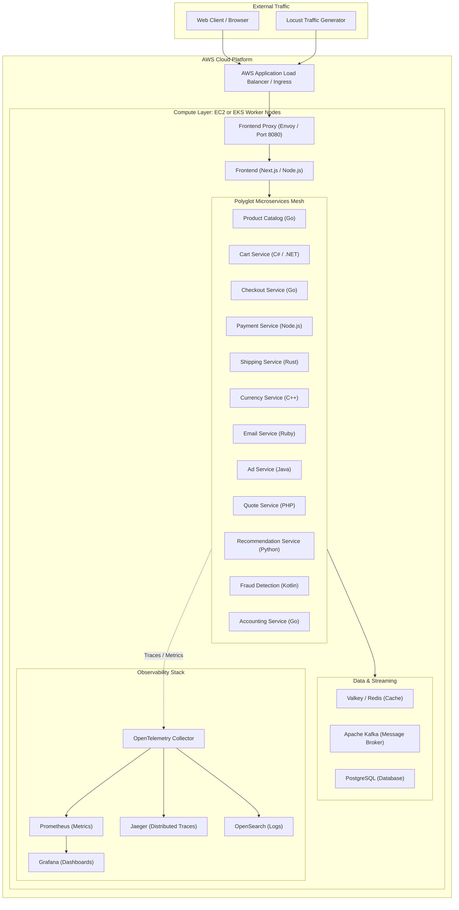
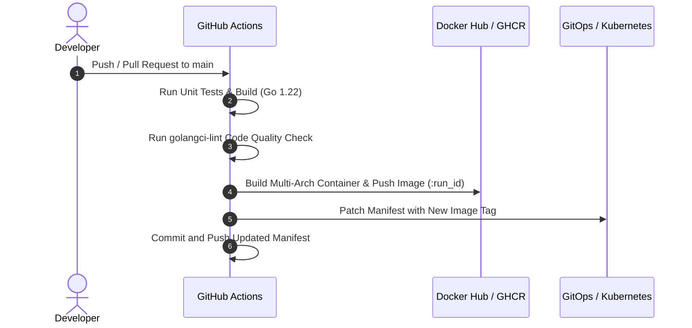

# Cloud & DevOps Microservices Deployment on AWS (EC2 & EKS)

[](https://aws.amazon.com/)
[](https://kubernetes.io/)
[](https://www.docker.com/)
[](https://github.com/features/actions)
[](https://opentelemetry.io/)
[](LICENSE)

An end-to-end, enterprise-scale DevOps implementation deploying a polyglot, distributed microservices application (*Astronomy Shop*) across **AWS EC2** and **AWS EKS (Elastic Kubernetes Service)**. 

This project demonstrates production-ready infrastructure provisioning, containerization, Kubernetes orchestration, automated CI/CD pipelines with GitHub Actions, and end-to-end observability using OpenTelemetry, Prometheus, Grafana, and Jaeger.

---

## 📌 Table of Contents

- [Project Architecture](#-project-architecture)
- [Microservices Ecosystem](#-microservices-ecosystem)
- [Deployment 1: AWS EC2 (Docker Compose)](#-deployment-1-aws-ec2-docker-compose)
- [Deployment 2: AWS EKS (Kubernetes Cluster)](#-deployment-2-aws-eks-kubernetes-cluster)
- [CI/CD Automation Pipeline](#-cicd-automation-pipeline)
- [Observability & Monitoring](#-observability--monitoring)
- [Verification & Access](#-verification--access)
- [Key DevOps Competencies Demonstrated](#-key-devops-competencies-demonstrated)
- [Clean-Up & Teardown](#-clean-up--teardown)

---

## 🏗 Project Architecture



---

## 📦 Microservices Ecosystem

The demo application consists of 14+ loosely coupled polyglot microservices communicating via **gRPC** and **REST APIs**, backed by messaging and in-memory caches:

| Microservice | Language / Framework | Description |
| :--- | :--- | :--- |
| **Frontend** | Next.js, Node.js | Customer-facing responsive web application |
| **Frontend Proxy** | Envoy | Ingress reverse proxy routing client requests |
| **Product Catalog** | Go | Exposes product inventory, search, and pricing |
| **Cart Service** | .NET / C# | In-memory shopping cart backed by Valkey (Redis) |
| **Checkout Service** | Go | Orchestrates order submission, payment, and shipping |
| **Payment Service** | Node.js | Simulates credit card authorization and payment |
| **Shipping Service** | Rust | Calculates shipping costs and coordinates delivery |
| **Currency Service** | C++ | Handles real-time currency conversion rates |
| **Email Service** | Ruby | Generates and sends order confirmations |
| **Recommendation** | Python | Suggests related products using browsing history |
| **Ad Service** | Java | Serves context-targeted advertisements |
| **Fraud Detection** | Kotlin | Evaluates orders for anomalous transactions |
| **Accounting** | Go | Processes invoice creation and tax calculations |
| **Quote Service** | PHP | Calculates customized shipping rates |

---

## 🚀 Deployment 1: AWS EC2 (Docker Compose)

For development and staging environments, the entire stack was deployed on an **AWS EC2 Ubuntu (t3.xlarge or larger recommended)** instance using Docker Compose:

### 1. Provision EC2 & Configure Security Groups
- **Inbound Rules:**
  - Port `22` (SSH): Restrict to your administrator IP
  - Port `8080` (Frontend Web UI & Proxy): HTTP access
  - Port `8084` (Grafana Dashboards): Metrics monitoring
  - Port `16686` (Jaeger UI): Distributed tracing

### 2. Host Configuration & Docker Setup
```bash
# Update and install Docker
sudo apt-get update && sudo apt-get install -y docker.io docker-compose-v2
sudo usermod -aG docker $USER
newgrp docker

# Verify Docker installation
docker --version
docker compose version
```

### 3. Deploy the Stack
```bash
# Clone the repository
git clone <YOUR_REPOSITORY_URL>
cd ultimate-devops-project-demo

# Launch services in detached mode
docker compose up -d

# Check running containers
docker compose ps
```

---

## ☸️ Deployment 2: AWS EKS (Kubernetes Cluster)

For high availability, scalability, and automated healing, the microservices were deployed to a managed **AWS EKS** cluster.

### 1. EKS Cluster Creation
Cluster provisioned using `eksctl` or AWS Console:
```bash
eksctl create cluster \
  --name devops-microservices-cluster \
  --region us-east-1 \
  --nodegroup-name standard-workers \
  --node-type t3.xlarge \
  --nodes 3 \
  --nodes-min 2 \
  --nodes-max 4 \
  --managed
```

### 2. Configure `kubectl` Context
```bash
aws eks update-kubeconfig --region us-east-1 --name devops-microservices-cluster
kubectl get nodes -o wide
```

### 3. Deploy Application Manifests
Deploy the service accounts, configuration, and microservices:
```bash
# Create dedicated ServiceAccount and RBAC
kubectl apply -f kubernetes/serviceaccount.yaml

# Apply the consolidated production deployment
kubectl apply -f kubernetes/complete-deploy.yaml

# Verify all deployments and pods
kubectl get pods -w
kubectl get services
```

### 4. Expose Frontend via LoadBalancer / Ingress
To access the frontend outside the cluster:
```bash
# Option A: Patch frontendproxy to type LoadBalancer (creates an AWS Network/Application Load Balancer)
kubectl patch svc opentelemetry-demo-frontendproxy -p '{"spec": {"type": "LoadBalancer"}}'

# Option B: Port-forward for secure local access
kubectl port-forward svc/opentelemetry-demo-frontendproxy 8080:8080
```

---

## 🔄 CI/CD Automation Pipeline

The repository integrates an automated **GitHub Actions** pipeline ([`.github/workflows/ci.yaml`](.github/workflows/ci.yaml)) implementing continuous integration and automated Kubernetes deployment tagging:



### Pipeline Key Steps:
1. **Continuous Integration (CI):**
   - Automatically triggered on pull requests to `main`.
   - Compiles Go source code and runs unit test suites.
   - Executes `golangci-lint` to enforce style and detect security anti-patterns.
2. **Containerization & Publishing:**
   - Authenticates to container registry using GitHub Secrets (`DOCKER_USERNAME`, `DOCKER_TOKEN`).
   - Builds lightweight Docker container images using Buildx.
   - Pushes versioned tags keyed to `${{ github.run_id }}`.
3. **Automated Manifest Deployment Tagging:**
   - Updates `kubernetes/productcatalog/deploy.yaml` with the freshly built immutable tag.
   - Commits changes back into the repository under automated bot identity.

---

## 📊 Observability & Monitoring

Telemetry and metrics are generated across every microservice and processed in real time:

- **Distributed Tracing (Jaeger):** Traces full user transactions across distributed gRPC and HTTP hops, capturing span durations and identifying network latency bottlenecks.
- **Metric Collection (Prometheus):** Scrapes RED (Rate, Errors, Duration) metrics, CPU/memory resource utilization, and queue lengths.
- **Visual Analytics (Grafana):** Pre-configured dashboards provide visual health summaries across all microservices.
- **Feature Flagging (flagd):** Dynamic feature rollouts without redeploying code.

---

## 🔍 Verification & Access

| Component | Default Port | Access Method |
| :--- | :--- | :--- |
| **Astronomy Shop Frontend** | `8080` | `http://<EC2-PUBLIC-IP>:8080` or `http://<ALB-DNS-NAME>:8080` |
| **Grafana Dashboards** | `8084` | `http://<EC2-PUBLIC-IP>:8084` (Default: `admin` / `admin`) |
| **Jaeger Tracing UI** | `16686` | `http://<EC2-PUBLIC-IP>:16686` |
| **Locust Traffic Generator** | `8089` | `http://<EC2-PUBLIC-IP>:8089` |

### Pod Health Verification
```bash
# Verify all pods are Running and Ready
kubectl get pods

# Check detailed status of frontend proxy
kubectl describe pod -l app.kubernetes.io/component=frontendproxy

# Stream logs from product catalog service
kubectl logs -l app.kubernetes.io/component=productcatalogservice -f
```

---

## 💡 Key DevOps Competencies Demonstrated

- **Multi-Environment Cloud Architecture:** Practical implementation of cloud infrastructure on AWS utilizing EC2 and managed EKS.
- **Microservices Orchestration:** Managing multi-container polyglot topologies, ClusterIP services, ConfigMaps, and volume persistence in Kubernetes.
- **CI/CD & GitOps:** Automated testing, containerization, Docker registry publishing, and declarative manifest tracking.
- **Cloud-Native Observability:** Implementing OpenTelemetry SDKs, collector pipelines, Prometheus metric scraping, and Grafana visualization.
- **Networking & Security:** Security group ingress control, Kubernetes RBAC ServiceAccounts, and reverse proxying with Envoy.

---

## 🧹 Clean-Up & Teardown

To avoid incurring ongoing AWS charges:

```bash
# If running on EC2:
docker compose down -v

# If running on EKS:
kubectl delete -f kubernetes/complete-deploy.yaml
eksctl delete cluster --name devops-microservices-cluster --region us-east-1
```
